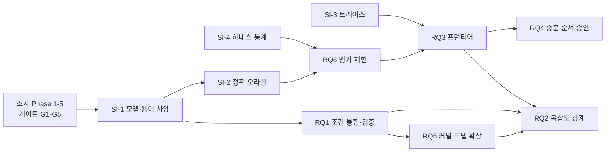

# 교착상태 조건 연구 — 6개 연구 진행 계획서 (v0.3)

- 작성일: 2026-10-29 (KST)
- 초안 작성: Claude(AI 조수) · 사람의 검토 전
- 관련 문서: `docs/01-survey-plan-and-research-questions.md`(이하 문서 01). 문헌 ID(F1, M6, S1, E1 등)와 확인 수준(A–D, X)은 문서 01의 표기를 그대로 쓴다. 이 문서에서 새로 인용하는 문헌은 P1~P15다(§11).
- 상태: 계획 초안. 일정·인력은 가정이며 §1.3과 §10에서 확정해야 한다. 가정에서 나온 숫자는 근거가 있는 값이 아니라 계획용 추정이다. v0.2(2026-10-29)는 G1 결과(문서 03)와 실행 환경 확인 결과를 반영했고, v0.3(2026-10-30)은 Phase 3 결과(문서 04 §9의 정정 7·8과 관련 서지)를 반영했다(§12).

---

## 0. 한 페이지 요약

- 실행 순서: 조사·게이트(G1~G5) → 공통 기반(SI-1~5) → RQ6 → RQ3 → RQ5(자료 코딩) → RQ1 → RQ5(모델) → RQ4 → RQ2.
- 원칙: 새 아이디어를 알고리즘으로 구현하는 일은 G5 이후에만 한다. 그 전에는 측정 도구와 기존 알고리즘의 기준 구현만 허용한다(브리프 §6, 문서 01 §2.3).
- 계층: 핵심(계층 1) RQ6·RQ3·RQ1(정의·정리·소규모 전수 검증), 선택(계층 2) RQ5·RQ4, 고난도·시간 상자(계층 3) RQ2와 RQ1의 기계 증명.
- 노력 추정(가정: 1인, 주 20시간): 전체 약 76주, 계층 1만 약 46주. 투입 시간이 2배가 되면 병렬화할 수 있는 구간에서 대략 절반으로 줄어든다.
- 중단·전환: G4 게이트에서 선행연구와의 동일/부분/없음을 판정해 중단·축소·흡수·진행을 결정한다. 모든 RQ는 반증 조건과 시간 상자를 갖는다.
- 먼저 정해야 할 것: 총 기간·주당 시간·최종 목표, 실행 환경(Linux), 유료 원문 접근 경로(§10).

---

## 1. 목표·범위·가정

### 1.1 목표와 성공의 정의

브리프의 연구 목적, 즉 교착상태 발생 조건을 재정의해 실제 운영체제에서 교착상태를 더 정확하고 효율적으로 예방할 수 있는지 규명하는 일을 6개 연구 질문(문서 01 §4)으로 나누어 검증한다.

성공은 새 알고리즘이 빠르다는 것이 아니다. 주요 주장이 모두 원문·증명·재현 가능한 실험에 연결돼 있고, 반증 결과와 비교 불가 결과도 보고되는 것이다.

### 1.2 6개 연구 한눈에 보기

| RQ | 방향 | 무엇을 | 시작 조건 | 핵심 산출물 | 예상 주(가정) | 계층 |
|---|---|---|---|---|---|---|
| RQ6 | C(기반) | 뱅커 개선 주장의 동일 조건 재현 | G2, SI-2(O1), SI-4 | 주장 인벤토리, 기준·변형 구현, 판정표, 재현 패키지 | 6 | 1 |
| RQ3 | C | 정책별 허용도–비용 프런티어 측정 | G3, G4, RQ6 | 정책 구현, 워크로드·트레이스, 프런티어 도표, 선택 지침 | 12 | 1 |
| RQ1 | A+B | 조건의 층위 분리와 모델별 관계의 통합·검증 | G2(정의), G4(증명) | 모델 매트릭스(A 수준), 정리표, 전수 검증, (선택) 기계 증명 | 14 | 1 |
| RQ5 | A | 인터럽트·간접 호출을 포함한 모델 확장 | G2, 자료 접근, RQ1(모델) | 커널 교착 49건 분류표·코드북·κ, 확장 모델 | 8 | 2 |
| RQ4 | C | 증분 위상 순서 기반 상시 락 순서 승인 | G4('부분/없음'), RQ3 하네스 | 구현 비교표, 프로토타입, 비용·거부율 | 6 | 2 |
| RQ2 | B | 제한 가정 아래 정확 판정의 복잡도 경계 | G3, RQ1 정의, RQ5 자료 | 복잡도 지도, 정리·증명 초안 | 12(시간 상자) | 3 |

### 1.3 가정과 미확정 항목

| 항목 | 현재 가정 | 확정 시점 |
|---|---|---|
| 인력·시간 | 사용자 1인 + AI 보조(Claude), 주 20시간 | 착수 전(§10 Q1) |
| 최종 목표 | 미정(논문, 학위, 오픈소스 중) | 착수 전(§10 Q2) |
| 실행 환경 | 사용자 PC는 Windows. 커널 트레이스와 성능 측정은 Linux(VM·별도 머신)가 필요하다. WSL2 사용 가능 여부는 미확인 | Phase 1 |
| AI 작업 환경의 제약 | (2026-10-29 확인) Claude의 클라우드 작업공간에서 Python 3.13(numpy, scipy, pandas, matplotlib, networkx), g++/gcc, Rust(cargo), Go, Node, Java 21, git 2.43을 쓸 수 있고 코어 2개, 메모리 약 8GB다. 공개 GitHub 저장소는 받을 수 있다(읽기). 그 밖의 외부 접속은 패키지 저장소와 웹 검색·열람 도구로 제한된다. gh 인증 토큰이 유효하지 않아 작업공간에서 저장소를 만들 수 없다. 사용자 PC에는 파일 읽기·쓰기와 작업공간→PC 파일 복사만 가능하고 PC에서 명령을 실행하는 도구는 없다. 성능 측정은 코어 2개의 공유 가상 환경이므로 상대 비교와 점근 기울기 위주로 한다. 커널 실험과 유료 원문 열람은 사용자 쪽 작업이 필요하다 | 상시 |
| 형식 검증 도구 | 후보만 제시(§5.3). 작업공간에 Java 21이 있으므로 Java 기반 도구(Alloy, TLC)는 jar를 받을 수 있으면 실행 가능하다. jar 확보 가능 여부는 Phase 2에서 확인한다 | Phase 2 |
| 공개 | 저장소는 공개 예정. 제3자 데이터는 재배포하지 않는다 | 저장소 생성 시 |
| 컴퓨팅 비용 | 사용자 공간 시뮬레이션 중심이라 낮다고 가정. 커널 실험은 VM 1대 | Phase 3 |

### 1.4 역할 분담(제안)

| 작업 | 사용자 | AI(Claude) |
|---|---|---|
| 의사결정(정의 선택, RQ 확정, 중단) | 결정 | 선택지와 근거 제시 |
| 유료 원문 확보 | 구독·PDF 제공 | 서지·URL 정리, 제공된 PDF의 발췌와 대조 |
| 정의·정리 초안, 반례 모델 | 검토·수정 | 초안 작성 |
| 코드(시뮬레이터·하네스·오라클) | 코드 리뷰 | 구현, 클라우드 작업공간에서 사용자 공간 실험 실행 |
| 커널·VM 실험 | 실행 | 스크립트·분석 |
| 이중 코딩(RQ5) | 최종 판정 | 보조 코더(독립성 한계를 보고서에 명시) |
| 문서·주장 대장 관리 | 검토 | 작성·갱신 |

---

## 2. 진행 원칙: 브리프 §5의 반영

| 브리프 §5 | 계획서 반영 |
|---|---|
| 1. 교과서·문헌으로 기존 이론 정리 | Phase 1~3, SI-1 모델·용어 사양서 |
| 2. 해결/미해결 구분 | 문서 01 §3 표를 G3에서 확정 |
| 3. 참신성 선주장 금지 | G4 게이트(동일/부분/없음 + 근거 링크) 전에는 '새롭다'고 쓰지 않음 |
| 4. 정의·가정·논증/실험 구분 | 주장 대장의 필드, 보고서 구조(정의·가정·논증 또는 실험·한계) |
| 5. 반례 적극 탐색 | RQ마다 반증 조건, RQ1 전수 반례 탐색, RQ6 적대적 입력 |
| 6. 복잡도·이용률·대기·동시성·구현 비용 고려 | RQ3 지표 M1~M8, RQ2 복잡도 지도 |
| 7. 동일 조건 비교 | SI-4 하네스(같은 입력·오라클·통계 절차) |
| 8. 성립하지 않으면 수정·폐기 | RQ별 중단 규칙, 부정 결과 보고 의무 |

---

## 3. 게이트와 단계

| 게이트 | 통과 조건 | 해제되는 작업 |
|---|---|---|
| G0 (현재) | 문서 01 완료 | Phase 1 |
| G1 | 문서 01 §6의 원문 대조를 마쳤거나 못 한 사유를 기록. 일정 재추정 | Phase 2 |
| G2 | SI-1(모델·용어 사양) 동결: deadlock 정의, 안전 상태 정의, 모델 매개변수 | SI-2(O1·O3), SI-4, RQ6의 WP6.1~6.2, RQ1의 WP1.1~1.2, RQ5의 WP5.1 |
| G3 | 비용표·복잡도 지도·시스템/실증 정리 완료. 일정 재추정 | SI-3, RQ3 하네스, RQ2의 WP2.1 |
| G4 | 각 RQ의 게이트 판정표 완성 | 진행·축소·흡수·중단 결정 |
| G5 | RQ 확정, 사전 분석 계획 커밋 | 새 아이디어의 구현, 본 실험, 증명 |

- G5 이전에 허용되는 선행 작업: ① 오라클·하네스 같은 측정 도구, ② 기존 알고리즘의 기준 구현(뱅커, wait-die/wound-wait, 순서화 등), ③ 정의·정리 초안(증명 완성은 제외). 문서 01 §2.3의 선행 착수 검토를 구체화한 것이며, 1인 순차 일정에서는 병렬 작업이 가능할 때만 쓴다.
- G4 판정에 따른 결정: 동일 → 중단하거나 재현 연구로 전환, 부분 → 차이를 명시해 축소하거나 다른 RQ에 흡수, 없음 → 진행(검색 한계를 함께 기록).
- 재추정 규칙: G1과 G3에서 실제 소요를 계획과 비교한다. 계획의 1.5배를 넘으면 계층 3을 제외하거나 범위를 줄인다.

---

## 4. 공통 기반 SI-1 ~ SI-5

### SI-1. 모델·용어 사양서 (`docs/spec/model-spec.md`)

- 내용: (a) deadlock의 정의. 문서 01 F10(레바인)의 죽은 상태 분류에서 하나를 고른다. (b) 예방/회피/탐지, 안전/불안전/교착의 정의(브리프 §4). (c) 모델 매개변수: 단위 수(단일/다중), 요청 형태(단일 단위/AND/OR/P-out-of-Q), 자원 종류(재사용/소모성), 선점 가능 여부, 정보 수준 K0~K3. (d) 정책 수준 속성과 상태 수준 술어의 형식 정의. (e) 표기 규약.
- 정보 수준 K0~K3은 본 계획의 작업 가설이다(문헌 분류가 아님). K0: 현재 상태만, K1: 최대 요구량 선언(뱅커), K2: 락 클래스 순서·의존 정보(정적 분석 또는 학습), K3: 프로그램 전체(제어 흐름) 정보.
- 완료 기준: 문서 01 모델 매트릭스의 모든 칸이 정의와 연결, 사람 검토 통과, 버전 태그 `spec-v1`. 이후 변경은 변경 기록과 영향 분석을 남긴다.

### SI-2. 정확 오라클 (`oracle/`)

- O1 뱅커 모델: 안전 순서의 존재로 안전 상태를 판정(F8의 순서 탐색)하고, 소규모에서는 순열 전수 탐색으로 교차 검증한다.
- O2 단일 인스턴스 락 프로그램: 스레드별 획득·해제 열(분기 없는 직선 코드)의 상태 공간을 전수 탐색한다. Safe(s) = s에서 모든 스레드가 종료되는 스케줄이 존재함(회피 관점), PossibleDeadlock(s) = s에서 교착 상태로 가는 스케줄이 존재함. 일반 순차 자원 할당에서 안전성 판정은 넓은 클래스에서 NP-완전이므로(문서 01 §1.3의 M3~M5, M9) 입력 크기 상한을 문서화한다.
- O3 일반화 요청 모델(AND/OR/P-out-of-Q): 현재 상태의 교착 판정(그래프 축소, 매듭). 소규모 전수 탐색과 교차 검증한다.
- 교차 검증: 같은 소규모 입력을 Alloy 6 또는 TLA+(TLC/Apalache)로 전수 검사해 구현과 판정이 일치하는지 본다(§5.3).
- 완료 기준: 입력 형식 정의, 소규모 전수 일치, 크기·시간 한계표, 단위 테스트.

### SI-3. 트레이스 포맷·수집 (`traces/`)

- 포맷: 이벤트 단위 레코드. 필드는 시각, 실행 문맥(스레드, 인터럽트 종류), 연산(요청·획득·대기·해제 등), 락·자원 식별자와 클래스, 모드(독점/공유), 호출 위치(선택).
- 수집 후보:
  - 사용자 공간: pthread 락 호출을 가로채는 방식. Dimmunix가 lock/unlock 호출을 가로채는 선례가 있다(S6). [A−]
  - 커널: lock:contention_begin/contention_end 트레이스포인트는 2022년에 추가됐고 lockdep 인프라에 의존하지 않도록 설계됐다(P9). lock:lock_acquire류 이벤트는 CONFIG_LOCKDEP가 켜진 커널에서 제공된다(P10의 perf lock 코드 주석). perf lock은 record·report·script·info·contention 하위 명령을 갖는다(P10). CONFIG_LOCK_STAT은 락 클래스 단위 통계를 /proc/lock_stat로 제공한다(P11). 커널 버전과 구성 옵션은 고정해 기록한다.
  - 합성 생성기.
- 완료 기준: 포맷 검증기, 샘플 트레이스(합성 + 사용자 공간 1건 이상), 수집 스크립트 문서, 라이선스·개인정보 점검.

### SI-4. 벤치마크 하네스·통계 프로토콜 (`bench/`)

- 구조: 정책 플러그인 인터페이스(요청·해제·타임아웃 훅), 워크로드 생성기 인터페이스, 결과 저장 포맷, 시드 관리.
- 통계: 반복 횟수, 요약 통계, 비교 방법을 사전 분석 계획에 먼저 적는다. 단순 평균 비교를 피하고 신뢰구간과 효과 크기를 보고한다. 비결정적 환경에서 통계적으로 엄밀하게 보고해야 한다는 주장은 P3, 반복 설계와 결과 요약 방법은 P2를 참고한다.
- 측정 편향: 실험 설정의 사소한 차이가 결론을 바꿀 수 있으므로 환경 요인을 점검하고 설정 무작위화를 쓴다(P4).
- 환경: Linux, CPU 고정, 주파수·SMT 설정 기록, 컨테이너 이미지 고정.
- 완료 기준: RQ6의 기준 구현으로 처음부터 끝까지 검증(같은 입력은 같은 출력, 재실행 시 요약 통계가 사전에 정한 허용 범위 안).

### SI-5. 재현성·주장 대장·아티팩트

- 주장 대장(문서 01 §2.5), BibTeX, 컨테이너화, 버전 고정, 그림·표 단위 재현 스크립트(`make reproduce`), 라이선스, DOI 아카이빙.
- 목표 배지(P1, ACM Artifact Review and Badging v1.1): Artifacts Available, Artifacts Evaluated(Functional, 가능하면 Reusable). 컨테이너 환경과 DOI 아카이빙(예: Zenodo)은 학회 아티팩트 평가 안내에서 권장되는 방식이다(P15). [B]
- Results Validated 배지의 두 유형은 원 저자의 아티팩트를 일부라도 쓰느냐로 나뉜다(Reproduced는 사용, Replicated는 미사용). RQ6의 각 재현 결과를 이 용어로 분류한다.

---

## 5. 연구별 계획

실행 순서대로 서술한다. 각 RQ는 가설, 선행 조건, 작업 패키지(WP), 판정, 위험, 중단 규칙을 갖는다.

### 5.1 RQ6. 뱅커 개선 주장의 동일 조건 재현 (계층 1, 첫 번째)

- 가설 H6: 선별한 개선 주장(복잡도, 성능, 활용도, 정확성)이 동일한 모델 가정, 동일한 정확 오라클, 동일한 워크로드와 통계 절차에서 유지된다.
- 판정 범주: 유지 / 조건부 유지 / 불유지 / 비교 불가(모델 가정이 달라 동일 조건이 성립하지 않음) / 재구현 불가(설명 부족). 불유지와 비교 불가도 결과로 보고한다.
- 선행 조건: G2, SI-2의 O1, SI-4. 주장 인벤토리(WP6.1)는 Phase 3의 A3 축 작업으로 앞당겨 한다.

초기 후보(인벤토리의 씨앗이며 완전한 목록이 아님. 번호 1~9는 `refs/rq6-inventory.md`의 R6-01~R6-09와 같은 순서다):

| 번호 | 문헌 | 저자 주장(요약) | 수준 | 범주 |
|---|---|---|---|---|
| 1 | Belik 1987, BIT (M6) | 뱅커 변형. 초록은 변형이 "특정한 있을 법한 조건" 아래 상각 최악 O(mn)이라고 쓰고(원래는 Θ(mn²)) 최대 두 배 빠르다는 취지의 문장도 담는다. 이 문장의 방향(최악에서도 최소 두 배인지, 최대 두 배인지)은 모호하다 | B | 소프트웨어 알고리즘 |
| 2 | Lang 1999, IEEE TSE (M8) | 영역별 근사 최대 청구를 써서 자원 활용도를 개선할 가능성을 주장 | B | 소프트웨어 알고리즘 |
| 3 | Lee·Mooney. TPDS 2006 (S11), ASP-DAC판으로 보이는 저자 사이트 PDF (S19), 학위논문 2004 (S20) | 하드웨어 병렬 뱅커. 최악 O(n), 최선 O(1)을 주장 | B, A−(S19) | 하드웨어(소프트웨어 재현은 구조 수준에 한정) |
| 4 | Dixit·Khuteta 2017, IJRITCC 5(8) (M39, P13) | 자원 개수를 실행 중 바꿀 수 있는 "동적 뱅커". 평균 실행 시간 약 9% 개선을 주장(논문 페이지에서 확인. 점근 복잡도는 없음) | B | 소프트웨어 알고리즘 |
| 5 | M42 "An Improved Safety Detection Algorithm Towards Deadlock Avoidance", 2020 (P13. 저자·발표처가 목록마다 다르다: 저자 Bimal Chandra Das·ISCAIE 2020 대 Begum·Faruque·Das·CNSA 2020) | 시간·공간 복잡도 개선 주장 | B | 소프트웨어 알고리즘 |
| 6 | Wicaksono 외, JEEMECS 6(1), 2023 (M41, P13) | 새 프로세스 도착 시 동적으로 대응하는 최적화. 복잡도와 정량 지표는 없다(인벤토리 R6-06) | A− | 소프트웨어 알고리즘 |
| 7 | Zohora 외, PLOS ONE 2024 (S13) | 평균·최악 O(nd)로 원래 O(n²d)보다 개선을 주장. 평가는 비교 횟수 | B, A− | 소프트웨어 알고리즘 |
| 8 | Bak 1984, RAIRO ITA (M23) | 자원 종류 수와 종류별 단위 수에 비례하는 시간의 안전성 검사를 주장(§5, 저자 주장). 다중 종류에서는 종류별 지역 안전이 충분하지 않아 별도 결합 정리를 쓰고, 특정 제약 아래 안전 상태 일부를 거부한다고 저자의 선행연구를 인용해 보고(§4) | A− | 소프트웨어 알고리즘(고전, 보수적 판정 가능성) |
| 9 | Shin·Choi 2012, 한국시뮬레이션학회논문지 (M25) | 2단계 선행 탐색 뱅커로 안전 상태 판별률과 처리량을 개선(대응 표본 t 검정) | B | 순차 자원 할당(제조 시스템) 맥락. OS 뱅커 모델과 다른 모델일 가능성이 높아 '비교 불가' 후보 |

후보 10번 이후(Li 2013 등), 분리·보류·제외 항목, 검색 기록은 `refs/rq6-inventory.md`에 있다(Phase 3의 WP6.1 1차 검색이며 체계적 검색이라고는 말할 수 없다). 그 인벤토리에서 본문으로 재구현 가능성을 확인한 것은 R6-06, R6-07 두 건이다(문서 04 §11.2).

기준 알고리즘의 복잡도 표기가 자료마다 다르다. Belik는 Θ(mn²)(M6), Zohora 외는 원래 알고리즘을 O(n²d)(S13)로 적는다. Li(M27)의 초록은 원래 알고리즘의 시간을 O(n³d)로 쓰고, 문헌에서 Θ(n²d)로 인용되는 값은 안전성 검사 부분만을 가리키는 오인용이라고 설명한다(B, 초록만). 한 학술 사이트의 글도 O(n³d)로 적는다(P14, C). O(n³d)가 무엇을 센 값인지(요청 하나의 처리인지 전체 시퀀스인지)는 본문이 필요하며, 이 불일치를 오류로 단정하지 않는다. 그러므로 WP6.2에서 기준(입력 크기 변수, 연산 단위, 사례 범주)을 먼저 정의하고 모든 주장을 같은 기준으로 환산한다. 변수·단위의 제안은 문서 04 §2.

| WP | 내용 | 산출물 | 완료 기준 | 주(가정) |
|---|---|---|---|---|
| 6.1 | 주장 인벤토리. 체계적 검색(키워드: banker's algorithm과 improved·optimized·dynamic, 기간 1985~2026, DBLP·Crossref·OpenAlex·Semantic Scholar·KoreaScience). 포함 기준은 뱅커 계열의 복잡도·성능·활용도·정확성 개선 주장이며 재구현이 가능한 설명이 있어야 한다. 제외·분리는 하드웨어 전용 평가 | 주장 대장 항목(문헌, 주장 유형, 가정, 재구현 가능성) | 검색 기록(질의·일자·결과 수)과 포함·제외 사유 | 1 |
| 6.2 | 기준 구현과 기준 정의. 교재식 안전성·자원 요청 알고리즘, F8과 일치하는 정확성 논증, 오라클(O1) 연결 | `bench/policies/banker/`, 기준 정의 문서 | 오라클과 소규모 전수 일치 | 1 |
| 6.3 | 개선안 구현. 설명이 모호하면 해석별로 모두 구현해 해석 민감도를 보고. 저자 코드가 있으면 사용 | 변형 구현, 해석 선택 기록 | 각 구현이 문헌의 예제를 재현 | 2 |
| 6.4 | 정확성 시험. 차등 테스트(안전/불안전 판정과 요청 허용/거부 일치), 무작위 + 경계 사례 + 소규모 전수. 보수적(안전을 불안전으로 판정)·비보수적(불안전을 안전으로 판정) 분류 | 시험 결과표, 반례 모음 | 모든 변형에 대해 판정 일치율과 반례 | 1 |
| 6.5 | 성능 측정. (n, m) 스윕, 평균·최악·적대적 입력, 경험적 점근 기울기(로그-로그 회귀), 환경 고정 | 측정 데이터, 분석 스크립트 | 사전 분석 계획대로 신뢰구간 보고 | 1 |
| 6.6 | 판정과 보고. 주장별 범주 판정, 재현 패키지 | 판정표, 보고서, 컨테이너 | 모든 주장에 범주와 근거 | 0.5~1 |

- 위험과 대응: 의사코드가 모호하다 → 해석별 구현과 저자 문의. 하드웨어 주장은 소프트웨어로 재현할 수 없다 → 범주를 분리. 저자가 응답하지 않는다 → 기록만 남기고 Replicated로 분류.
- 태도: 불일치를 곧바로 오류로 단정하지 않는다. 모델 가정 차이를 먼저 확인한다.
- 중단 규칙: 재구현 가능한 주장이 사전에 정한 최소 건수(WP6.1 종료 시 사전 분석 계획에 기록)에 못 미치면 인벤토리 범위를 넓히거나, 재현 없이 문헌 비교로 축소한다. Phase 3 인벤토리에서 의사코드를 본문으로 확인한 소프트웨어 주장은 2건(R6-06, R6-07)이어서, 최소 건수(제안 4건, 인벤토리 §8)를 사람이 정해야 한다(§10 Q8). 모든 주장이 비교 불가로 판정되면 문헌 간 모델 가정 불일치 지도를 결과로 삼고 종료한다.

### 5.2 RQ3. 정책별 허용도–비용 프런티어 측정 (계층 1)

- 가설 H3: 정확한 안전 오라클 대비 불필요한 제한 비율, 요청당 비용, 완료 시간에서 다른 정책에 지배되지 않는 설계점이 둘 이상 있고, 워크로드 군에 따라 최적 정책이 달라진다.
- 반증: 한 정책이 모든 워크로드 군과 모든 지표에서 유의하게 우세하면 프런티어가 퇴화한 것이다. 이 경우 그 사실을 결과로 보고하고 종료한다.
- 선행 조건: G3, G4, RQ6(하네스와 오라클 검증), SI-3.

정책 목록(모두 기존 방식. 분류는 SI-1에서 확정하며, 원문 표현과 본 연구 분류를 병기):

| 코드 | 정책 | 분류(잠정) | 모델 가정 | 근거 |
|---|---|---|---|---|
| P-ORD | 락 클래스 순서화 | 예방(순환 대기 제거) | 순서 정의 필요 | F6, T3 |
| P-ALL | 일괄 요청 | 예방(점유-대기 제거) | 필요 자원의 사전 지식 | F6 |
| P-RET | 반납 후 재시도(trylock + 백오프) | 예방(비선점 제거) | 반납 가능한 자원 | F6, T3 |
| P-WD | wait-die | 예방(타임스탬프) | 롤백 가능 | S2, S15 |
| P-WW | wound-wait | 예방(선점형 타임스탬프) | 롤백 가능 | S2, S3 |
| P-PCP | 우선순위 천장 프로토콜 | 예방/회피 경계(SI-1에서 확정) | 우선순위·사용 자원의 사전 지식 | S4 |
| P-BNK | 뱅커 알고리즘 | 회피 | 최대 요구량 선언 | F3, F8 |
| P-RAG | 단일 인스턴스 그래프 기반 회피 | 회피(교재·강의 서술, C) | 단일 인스턴스 | M7, T6(UCSD 강의노트) |
| P-MIX | 자원 클래스별 혼합 | 혼합 | 클래스 구분 | F11 |
| P-INC | 증분 위상 순서 승인 | RQ4가 G4를 통과한 경우에만 추가 | 락 클래스 의존 그래프 | RQ4 |
| B0 | 무정책(교착 허용) | 기준선 | - | - |
| B1 | 탐지·복구(주기적 대기 그래프 탐지 + 희생자 선택) | 기준선 | - | M14, M15 |

워크로드:

| 층 | 내용 |
|---|---|
| L1 합성 | 파라미터: 스레드 수, 락·자원 수, 중첩 깊이, 락 선택 분포, 순서 위반 확률, 임계구역 길이 분포, 다중 인스턴스의 단위 수, 정보 수준(K0~K2) |
| L2 고전 문제 | 식사하는 철학자, 계좌 이체(락 2개) 등 |
| L3 사용자 공간 트레이스 | 대상 앱은 Phase 3에서 선정. Dimmunix 평가 대상(MySQL, SQLite 등)이 후보(S6, A−) |
| L4 커널 트레이스(선택) | perf lock 등으로 수집(SI-3). Linux VM이 있을 때만 |
| L5 사례 기반 | E2의 교착 사례에서 추출한 락 순서 패턴을 합성 템플릿으로 추상화(RQ5와 공유) |

지표:

| 코드 | 지표 | 정의 |
|---|---|---|
| M1 | 불필요한 제한 비율 | 정확 오라클이 안전으로 판정한 전이 중 정책이 거부·지연·중단(롤백)시킨 비율. 오라클을 쓸 수 있는 소규모에서 정확하고, 큰 규모에서는 표본·근사이며 한계를 명시 |
| M2 | 교착 발생 | 예방·회피 정책은 0이어야 한다(안전성 검증). B0·B1에서는 빈도 |
| M3 | 요청당 비용 | 중앙값과 p99 |
| M4 | 메모리 | 정책 상태의 크기 |
| M5 | 완료 시간·처리량 | makespan |
| M6 | 대기 시간 분포 | 꼬리 포함 |
| M7 | 롤백·재시도 횟수 | |
| M8 | 기아 지표 | 최대 연속 거부·대기. 홀트의 논평(F4)이 교착 예방이 영구 봉쇄를 없애지 않는다고 지적하므로 반드시 측정한다 |

설계와 판정: 정책 × 워크로드 파라미터의 요인 설계. 프런티어는 사전에 정의한다. 정책 A가 B를 지배한다는 것은 모든 지표에서 A가 B보다 나쁘지 않고 적어도 한 지표에서 통계적으로 유의하게 좋다는 뜻이다. 지표 후보는 M1, M3, M5이며 사전 분석 계획에서 확정한다.

| WP | 내용 | 산출물 | 완료 기준 | 주(가정) |
|---|---|---|---|---|
| 3.1 | 정책 구현과 건전성 검증. 소규모 모델 검사로 교착 0을 확인하고 차등 테스트. 기아 부재는 별도 속성이므로 공정성 가정 아래 검증을 시도하고 불가하면 M8로만 보고 | `bench/policies/`, 검증 로그 | 모든 정책이 소규모 전수 검사 통과 | 3 |
| 3.2 | 워크로드 생성기(L1, L2, L5) | `bench/workloads/` | 파라미터화와 시드 재현 | 2 |
| 3.3 | 트레이스 수집(L3, 선택 L4) | `traces/` | 포맷 검증 통과 | 2 |
| 3.4 | 본 실험 | 원자료 | 사전 분석 계획대로 실행 | 2 |
| 3.5 | 분석: 프런티어, 민감도, 워크로드 영향 | 도표, 보고서 | 지표별 신뢰구간 | 2 |
| 3.6 | 재현 패키지 | 컨테이너, 스크립트 | Functional 배지 기준 충족 | 1 |

- 위험: 구현 오류가 결과를 왜곡한다 → 오라클·차등 테스트·두 번째 독립 구현. 워크로드가 대표성이 없다 → 3층 설계(합성·실제·사례)와 한계 명시. 오라클 한계로 M1을 큰 규모에서 못 잰다 → 소규모 정확 측정과 큰 규모 표본 측정을 분리 보고. 플랫폼 잡음 → Linux, CPU 고정, 상대 비교만 주장.
- 중단 규칙: 프런티어 퇴화 시 결과로 보고하고 종료. 동일한 비교 연구가 G4에서 발견되면 재현 연구로 전환.

### 5.3 RQ1. 조건의 층위 분리와 모델별 관계의 통합 형식화 (계층 1)

- 가설 H1: 자원 모델 클래스(단위 수 × 요청 형태 × 자원 종류) 안에서, 정책 수준 속성과 상태 수준 술어로 나눈 정의 체계가 모델마다 다음 정리 유형을 만족하도록 정리된다.
  - T1 필요성: 교착이면 네 조건이 정책 수준과 상태 수준에서 성립한다.
  - T2 충분성·동치: 모델별 상태 술어(순환, 매듭, 축소 불가능성)와 교착의 관계(동치, 한 방향, 불성립을 반례로 입증).
  - T3 함의 구조: 상태 수준에서 조건 사이의 함의(예: 순환 대기 상태가 점유-대기 상태를 함의).
  - T4 예방 기법의 건전성: 기법별로 어떤 정책 수준 속성을 제거·제한하는지, 어떤 모델에서 교착 도달이 불가능한지, 어떤 모델에서는 불충분한지.
- 반증: 같은 통합 결과가 이미 문헌에 있다(G4 '동일') → 폐기 또는 축소. 소규모 전수 검사에서 정리의 반례가 나온다 → 정리 수정 또는 적용 범위 한정.
- 선행 조건: G2(정의), G4(증명 투입 여부), SI-2.

| WP | 내용 | 산출물 | 완료 기준 | 주(가정) |
|---|---|---|---|---|
| 1.1 | 문헌 정의 비교표(문서 01의 A1 축) | `docs/rq1/definitions.md` | 불일치 항목마다 원문 근거(A) | 2 |
| 1.2 | 모델 사양(SI-1)과 정의 체계 | `docs/spec/` | G2 통과 | 2 |
| 1.3 | 정리 목록과 증명 초안(T1~T4) | `docs/rq1/theorems.md` | 정리마다 가정·증명 위치·확인 수준 | 4 |
| 1.4 | 소규모 전수 검증과 반례 탐색 | `formal/rq1/`, 반례 로그 | 모든 정리가 통과하거나 반례로 수정됨 | 3 |
| 1.5 (선택) | 기계 증명(핵심 정리 3개 이상) | `formal/rq1/proofs/` | 증명 보조기가 증명을 검사 | 4 |

- WP1.4 도구: Alloy 6(가변 상태와 선형 시간 논리를 지원하며 alloytools.org 첫 화면 기준 최신 릴리스는 6.2.0, 2025-01-09 — 설치 시 최신판 재확인, P5) 또는 TLA+(TLC는 명시적 상태 열거, Apalache는 SMT 기반 기호 모델 검사기, P7). 두 가지를 같은 소규모 입력으로 비교해 선택한다.
- 모델링 주의: Alloy 6의 분석은 무한 트레이스를 전제하므로 유한 트레이스로 끝나는 교착은 stuttering 같은 장치로 명시적으로 모델링해야 한다(P6). TLA+에서 교착 부재를 어떤 동작이 가능한 상태로 정의한다는 포럼 설명이 있어(P6, C), 일부 프로세스는 진행하고 일부만 교착인 자원 교착과 다를 수 있다. 따라서 교착은 별도 상태 술어로 정의하고 그 도달 가능성을 검사한다.
- 초기 범위(성능에 따라 조정): 프로세스 4개 이하, 자원 종류 3개 이하, 종류당 단위 3개 이하. 소규모 전수 검사는 반례를 찾는 데 효과적이지만 정리의 증명은 아니다. 모든 크기에 대한 보장은 수학적 증명 또는 기계 증명이 필요하다.
- WP1.5 도구 후보: Lean 4 + Mathlib, Isabelle/HOL, Rocq. Coq는 Rocq Prover로 개명됐고 9.0이 개명 후 첫 릴리스(2025-03-12)다(P8). 설치 시 최신 안정판을 확인한다. 선택 기준은 사용자의 숙련도, 그래프·순서론 라이브러리, 설치·유지 비용이며 Windows 지원 여부는 설치 시 확인한다.
- 위험: 중복(통합 결과가 이미 존재), 형식화 비용 과다, deadlock 정의 선택에 따른 결과 변동 → G2에서 정의를 고정하고 변경 시 영향 분석. 기계 증명은 CP4(§6)에서 진행 여부를 결정.
- 중단 규칙: G4에서 '동일' → 축소 또는 중단. WP1.3 도중 같은 정리가 문헌에서 발견되면 그 정리는 재현으로 재분류한다.

### 5.4 RQ5. 인터럽트·간접 호출을 포함한 조건 모델 확장 (계층 2)

- 가설 H5: 요청의 자율성 가정(프로세스가 스스로 요청)을 완화하고 실행 문맥 종류를 추가한 확장 모델이, 자율 요청 모델 + 상태 수준 순환 대기만으로는 설명되지 않는 커널 교착 사례를 설명한다.
- 반증: 기존 모델과 lockdep의 사용 상태 규칙(S1)으로 사례 대부분이 이미 설명되면 확장의 추가 설명력이 없다. 이 경우 기존 모델의 충분성을 결과로 보고하고 종료한다.
- 자료: E2의 공개 저장소(P12). 저장소에는 README.md와 dataset.csv만 있고 LICENSE 파일이 없다(커밋 ffcad0c, 2026-10-29 확인). 열은 커밋 해시, 버그 패턴, 인터럽트 의존 여부, 하드웨어 의존 여부, 실행 문맥 수, 동기화 오용, 발견 경로다. [A] 200행 중 버그 패턴이 deadlock인 행이 49개로 논문 수치와 일치한다(문서 03 §3). 라이선스가 없으므로 원본 표를 복제하지 않고 커밋 해시와 자체 분류만 저장한다. 열 정의 주의: 논문은 스레드 수를 셀 때 인터럽트 핸들러를 별도 스레드로 세지 않고(§4.2), '인터럽트 기반'은 관련 코드 영역이 인터럽트 처리로만 도달 가능할 때로 정의한다(§3.1). 단일 스레드 교착 16건 중 이 열이 true인 것은 없으나 논문은 인터럽트 재진입을 이중 락의 주요 원인으로 서술하므로, 이 열만으로 16건의 원인을 판단하지 않고 사례별로 코딩한다.
- 선행 조건: G2, 자료 접근(WP5.1), 모델 부분(WP5.4)은 RQ1의 정의 체계.

| WP | 내용 | 산출물 | 완료 기준 | 주(가정) |
|---|---|---|---|---|
| 5.1 | 자료 준비. dataset.csv에서 버그 패턴이 deadlock인 행을 필터(논문 기준 49건과 대조). 각 커밋의 패치·메시지·메일링 리스트 논의는 링크로만 기록 | `analysis/rq5/index.csv`(해시와 링크) | 49건 확인 | 0.5 |
| 5.2 | 코드북과 파일럿. 변수: 요청 자율성(스레드 자체 요청 / 인터럽트로 인한 암묵적 재진입 / 간접 호출을 통한 재진입), 문맥 종류, 락 종류, 동일 클래스 중첩, 관여 락 수, 자기 대기(한 프로세스가 이미 쥔 자원을 다시 요청, 길이 1 사이클) 여부, E2의 스레드 수 계수 규칙(인터럽트 핸들러 비계수)과의 대응, 기존 모델로 설명 가능 여부, lockdep 규칙으로 설명 가능 여부. 10건을 이중 코딩해 κ 산출 | 코드북, 파일럿 결과 | κ의 합격선을 파일럿 전에 사전 등록(E2의 보고치 0.63~0.92를 참고) | 2 |
| 5.3 | 전체 코딩과 불일치 해소 | `analysis/rq5/coding.csv` | 모든 49건 코딩, κ 보고 | 1.5 |
| 5.4 | 확장 모델 정의(RQ1 체계 위). 비자율 요청(인터럽트 진입이 현재 문맥에 요청을 삽입), 문맥 클래스. 간접 호출은 요청 집합의 불확실성으로 다루되 조건 정의의 문제가 아니라 분석의 문제일 수 있으므로 범위를 한정 | `formal/rq5/`, `docs/rq5/model.md` | 정의와 정리 초안 | 3 |
| 5.5 | 검증. 49건 중 기존 모델로 설명되는 비율과 확장 모델로 설명되는 비율. lockdep 사용 상태 규칙이 확장 모델의 정리로 환원되는지 | 보고서 | 비율과 사례 근거 | 1 |

- 근거가 되는 수치: 교착 49건이 전체 200건의 24.5%이고 그중 32.7%가 단일 스레드이며 주로 인터럽트 재진입과 간접 호출이 원인이다(E2, A). 이 수치는 mainline 수정 커밋에서 키워드 필터로 고른 표본이므로 일반화하지 않는다.
- 위험: 커널 전문 지식 부족으로 사례를 잘못 해석한다 → 이중 코딩, 외부 전문가 검토, 불확실한 사례는 '불확실'로 코딩. AI를 두 번째 코더로 쓰면 독립성에 한계가 있다 → 불일치 해소와 최종 판정은 사람이 한다.
- 중단 규칙: 확장 모델의 추가 설명력이 없으면 결과를 보고하고 종료. 자료 접근이 불가능하면 E2와 같은 방법(mainline 수정 커밋의 키워드 필터 + 수동 검증)으로 자체 표본을 만들되 소요가 늘어나므로 G3에서 재추정한다.

### 5.5 RQ4. 증분 위상 순서 기반 상시 락 순서 승인 (계층 2, G4 의존)

- 가설 H4: 락 클래스 의존 그래프를 증분 위상 순서로 유지하는 승인 정책이 RQ3 프런티어에서 지배되지 않는 설계점이다.
- 반증: 기존 구현(디버그용 락 순서 검사, lockdep류) 대비 요청당 비용에서 통계적으로 유의한 이점이 없거나, 실제 워크로드에서 거부율이 과다하다.
- 중복 위험이 높다. 같은 자료구조가 락 순서 검사에 이미 쓰였다는 서술이 있고(S10, C), 증분 순환 탐지 논문이 교착 탐지를 응용 분야로 든다(G2). G4에서 '동일'이면 RQ3의 정책 항목(P-INC)으로 흡수하고 독립 RQ로는 종료한다.

| WP | 내용 | 산출물 | 완료 기준 | 주(가정) |
|---|---|---|---|---|
| 4.1 | 선행 구현 분석: Abseil의 락 순서 검사, lockdep, Goodlock 계열(S8), Dreadlocks(S7)의 자료구조·비용·적용 문맥(디버그 전용 여부) | 비교표 | 소스·문헌 근거 | 1.5 |
| 4.2 | 알고리즘 후보 구현과 마이크로벤치: 단순 DFS(기준), Pearce–Kelly(G3), 단방향 탐색(G1의 총 시간 상한 O(n² log n)과 O(m·min{m^(1/2), n^(2/3)}) 참고) | `bench/policies/inc/` | 요청당 비용 대 그래프 크기·삽입 패턴 | 2 |
| 4.3 | 거부율 측정(RQ3의 오라클·트레이스): 순환을 닫는 의존 추가 이벤트 중 실제 교착이 가능한 비율 | 분석 보고 | 신뢰구간 | 1 |
| 4.4 | 우회 경로(trylock, wound, 대기)를 결합한 정책 설계와 RQ3 하네스 평가 | 정책 정의, 결과 | 프런티어 위치 | 1.5 |

- 범위 한정: 구현은 사용자 공간 프로토타입까지다. 커널에 적용할 때의 문제(스핀락·인터럽트 문맥에서 그래프를 갱신하는 비용과 동기화)는 분석 항목으로만 다루고 미검증으로 표시한다.
- 중단 규칙: 요청당 비용에서 이점이 없으면 결과를 보고하고 종료.

### 5.6 RQ2. 제한 가정 아래 정확 판정의 복잡도 경계 (계층 3, 시간 상자 8주)

- 가설 H2: 정보 수준과 구조 제한(사이클 길이, 락 중첩 깊이, 단일 인스턴스, 인터럽트 문맥 포함)으로 정의한 클래스 중, 과잉 거부 없는 정확 판정이 다항 시간 이하로 가능한 클래스가 문헌 밖에도 존재한다.
- 반증: 제한 클래스에서도 NP-난해임이 증명된다(그 자체가 결과). 이미 다항 알고리즘이 알려져 있다. 가정이 실증 자료와 맞지 않는다.
- 선행 조건: G3(복잡도 지도의 문헌 부분), RQ1 정의, RQ5 자료(가정의 실증 근거).

| WP | 내용 | 산출물 | 완료 기준 | 주(가정) |
|---|---|---|---|---|
| 2.1 | 문제 격자 정의: 정보 수준(K0~K3) × 구조 제한 × 질문 유형(현재 상태 교착 판정, 안전성 판정, 최대 허용 정책 계산) | `docs/rq2/grid.md` | 격자의 모든 칸에 이름 | 1 |
| 2.2 | 문헌 기반 채우기: 칸마다 알려진 복잡도(P, NP-완전, PSPACE-완전, 미해결), 출처, 가정(M3~M5, M9, M1, S9 등) | 복잡도 지도 | 모든 칸에 상태(알려짐·미해결·미확인) | 3 |
| 2.3 | 빈칸 우선순위: 실증 근거가 있는 제한(E1의 97%, E2의 98.5%)에 해당하는 칸부터 | 우선순위표 | 근거와 한계 명시 | 1 |
| 2.4 | 증명·알고리즘 시도(시간 상자) | 정리·증명 초안 | 증명 또는 막힌 지점 기록 | 8 안에서 3 |
| 2.5 | 오라클 교차 검증(SI-2) | 일치 결과 | 소규모 일치 | 1 |

- 위험: 증명 난도가 높다 → 시간 상자(8주) 만료 시 지도 자체를 산출물로 종결. 제한 클래스가 현실과 맞는지 비판받을 수 있다 → E1과 E2의 표본 한계를 명시하고 가정을 실증과 분리해 기술.
- 중단 규칙: 시간 상자 만료. 진전이 없으면 문헌 기반 복잡도 지도와 미해결 칸 목록으로 종결한다.

---

## 6. 통합 일정과 의존성

### 6.1 의존성



화살표는 선행 산출물을 사용한다는 뜻이다. RQ6이 하네스와 오라클을 처음 검증하고, RQ3과 RQ4가 그 하네스를 재사용한다. RQ1의 정의 체계는 RQ5와 RQ2가 쓰고, RQ5의 실증 가정과 RQ3의 워크로드 분류는 RQ2의 가정 근거가 된다.

### 6.2 1인 순차 일정(가정: 주 20시간)

| 단계 | 내용 | 기간(주) | 누적(주) | 게이트·체크포인트 |
|---|---|---|---|---|
| A | Phase 1~5 조사·게이트 | 16 | 16 | G1(4주), G2(8주), G3(12주), G4(14주), G5(16주) |
| B | SI-2(O1·O3) + SI-4 + RQ6 | 8 | 24 | CP1: 하네스·오라클 검증 완료 |
| C | SI-3 + RQ3 | 12 | 36 | CP2: RQ4를 RQ3에 흡수할지 결정 |
| D | RQ5-A 자료 코딩(WP5.1~5.3) | 4 | 40 | CP3: 코드북·κ 확정 |
| E | RQ1(전수 검증까지 10주 + 기계 증명 4주) | 14 | 54 | CP4: 기계 증명 진행 여부 |
| F | RQ5-B 확장 모델(WP5.4~5.5) | 4 | 58 | |
| G | RQ4 | 6 | 64 | RQ3에 흡수되면 생략 |
| H | RQ2 | 12 | 76 | 시간 상자 종료 |

- 계층 1만 수행: A(16) + B(8) + C(12) + E의 전수 검증(10) = 46주.
- 압축 방법: 주당 투입 시간을 늘린다. 조사 단계(A)의 원문 대조와 RQ6의 인벤토리(WP6.1)는 병행한다. 계층 3을 제외한다.
- 모든 추정은 작업 분해에 따른 계획용 가정이다. G1과 G3에서 재추정한다(§3).

### 6.3 첫 2주 실행 항목

| 번호 | 항목 | 담당 |
|---|---|---|
| 1 | 유료 원문 접근 경로 확인(기관 구독, 상호대차, PDF 제공). 우선순위: F1 §2, F2, F3, M3~M5, M15 | 사용자 |
| 2 | Linux 실행 환경 결정(VM, 별도 머신, WSL2 가능성 점검) | 사용자 |
| 3 | F1·F2 원문 대조 시작, 모델 매트릭스의 C 항목을 A로 승격하는 작업 | AI(제공된 PDF에 한함) |
| 4 | E2 dataset.csv 열람과 49건 필터(라이선스 확인 전 복제하지 않음) | AI |
| 5 | RQ6 주장 인벤토리의 검색 프로토콜 작성과 1차 검색 | AI |
| 6 | 형식 도구 설치 가능성 확인(Alloy 6, TLC/Apalache, Lean·Isabelle·Rocq 후보) | AI(작업공간), 사용자(PC) |

---

## 7. 품질 관리·재현성·편향 통제

- 주장 대장: 모든 보고서의 주장을 대장 ID로 연결한다. ID 형식은 `C-RQ3-001`. 수준이 C 이하인 주장은 논증의 전제로 쓰지 않는다.
- 사전 분석 계획(`prereg/RQx.md`): 실험·분석 전에 아래 항목을 커밋해 타임스탬프를 남긴다. 사후 변경은 허용하되 사유와 영향을 기록한다.
  - 가설(반증 가능한 형태), 데이터·워크로드·제외 기준, 지표와 계산식, 비교·통계 절차(반복 수, 요약, 신뢰구간 방식), 판정 규칙(성공·부분·실패), 허용되는 사후 변경
- 구현 검증: 정책마다 ① 소규모 전수 모델 검사로 교착 0 확인(해당 모델에서), ② 오라클 또는 두 번째 독립 구현과의 차등 테스트, ③ 속성 기반 테스트.
- 측정 편향: 실험 설정 요인을 점검하고 설정 무작위화를 쓴다(P4). 반복 설계는 P2, 통계 분석은 P3를 참고한다.
- 이중 코딩(RQ5): 코드북을 사전 등록하고 κ를 보고한다. AI는 보조 코더이며 독립성 한계를 보고서에 적는다.
- 부정 결과: 반증·비교 불가·미해결도 같은 형식으로 보고하고 원자료를 보존한다.
- 인용: 브리프 §6에 따라 확인 가능한 출처만 쓰고 확인하지 못한 정보는 X로 둔다. AI가 작성한 서지는 URL과 확인 수준을 기록하고 사람 검증 대상 목록을 유지한다.
- 공개·윤리: 제3자 데이터는 링크와 해시만 저장한다. 저자 문의는 정중하게 하고 불일치를 오류로 단정하지 않는다. 새로 발견한 커널 버그가 있다면 공개 전에 보고 절차를 따른다. 문서에는 AI 작성 사실을 표기한다.

---

## 8. 위험 관리

| 위험 | 징후 | 영향 | 완화 | 대응(트리거) |
|---|---|---|---|---|
| 유료 원문 접근 불가 | G1까지 F1·F2·F3 미확보 | 모델 매트릭스가 C 수준에 머묾 | 초기에 접근 경로 확보(구독, 상호대차, 저자 요청) | 해당 칸을 '원문 미확인'으로 표기하고 결론에서 제외 |
| 선행연구 중복 | G4에서 '동일' 판정 | RQ 폐기·전환 | 게이트로 조기 판정, 측정 연구(RQ6, RQ3)는 영향이 작음 | 재현 연구로 전환하거나 중단 |
| 정의 선택에 따른 결과 변동 | deadlock 정의를 바꾸면 정리가 바뀜 | RQ1, RQ5, RQ2 흔들림 | SI-1에서 정의 동결, 변경 시 영향 분석 | 변경 기록과 재검증 |
| 구현 오류 | 정책이 교착 0을 못 지킴, 오라클 불일치 | 결과 왜곡 | 오라클·차등 테스트·이중 구현 | 결과 폐기 후 재측정 |
| 워크로드 대표성 부족 | 합성과 실제 결과가 갈림 | 일반화 불가 | 3층 설계, 한계 명시 | 주장 범위 축소 |
| 환경 제약 | Windows만 가능, 커널 트레이스 불가 | L4와 커널 측정 불가 | Linux VM 확보, 불가하면 L4를 선택 사항으로 | 사용자 공간·공개 사례로 대체 |
| 일정 초과·범위 팽창 | 단계 실제 소요가 계획의 1.5배 | 후반 RQ 미완 | 시간 상자, 계층 구분, 재추정 | 계층 3 제외 |
| 형식 증명 비용 과다 | WP1.5가 계획의 2배 | RQ1 지연 | 전수 검증 수준에서 종결 가능 | CP4에서 중단 |
| 데이터 라이선스 | E2 저장소 라이선스 미확인 | 재배포 문제 | 해시·링크·자체 분류만 저장 | 저자에게 문의 |
| AI 보조의 오류 | 허위 서지, 원문 오독 | 신뢰 상실 | 수준 표기, 사람 검증 대상 목록, 원문 대조 | 해당 항목 철회 |
| 측정 잡음 | 가상화·전원 설정 변동 | 비교 불가 | Linux, CPU 고정, 설정 무작위화 | 상대 비교만 주장하고 한계 명시 |

---

## 9. 산출물과 저장소 구조

```
<repo>/
├─ docs/
│  ├─ 01-survey-plan-and-research-questions.md
│  ├─ 02-research-execution-plan.md
│  ├─ spec/model-spec.md          # SI-1
│  └─ rq1/ ... rq6/               # RQ별 정의·보고서
├─ refs/                          # references.bib, claims-ledger.md
├─ prereg/                        # RQ별 사전 분석 계획
├─ formal/                        # RQ1, RQ5 모델·증명
├─ oracle/                        # SI-2
├─ traces/                        # SI-3 포맷·수집 스크립트(제3자 원자료 제외)
├─ bench/                         # SI-4 하네스, 정책·워크로드 구현
├─ experiments/                   # rq3/, rq4/, rq6/ 설정·결과·분석
├─ analysis/rq5/                  # 코드북, 분류표
└─ README.md
```

| RQ | 최종 산출물 |
|---|---|
| RQ6 | 주장 인벤토리, 판정표, 재현 패키지 |
| RQ3 | 프런티어 도표, 정책 선택 지침, 재현 패키지 |
| RQ1 | 모델 매트릭스(A 수준), 정리표, 반례 로그, (선택) 기계 증명 |
| RQ5 | 코드북, 49건 분류표, κ, 확장 모델 문서 |
| RQ4 | 비교표, 프로토타입, 비용·거부율 보고 |
| RQ2 | 복잡도 지도, 정리·증명 초안 또는 미해결 목록 |

---

## 10. 확정해야 할 사항

| 번호 | 질문 | 영향 |
|---|---|---|
| Q1 | 총 기간, 주당 투입 시간, 인원 | §6 일정 전체 |
| Q2 | 최종 목표(논문, 학위, 오픈소스) | 계층 선택, 산출물 형식, 공개 시점 |
| Q3 | Linux 실행 환경(VM, 별도 머신, WSL2) | L4, 성능 측정, RQ3·RQ4 |
| Q4 | 유료 원문 접근 경로 | G1 통과, RQ1의 A 수준 확보 |
| Q5 | 형식 검증 도구 경험·선호(Alloy, TLA+, Lean, Isabelle, Rocq) | RQ1의 WP1.4~1.5 |
| Q6 | 구현 언어 선호(Rust, C++, Python 등) | SI-2, SI-4 |
| Q7 | 저장소 공개 시점과 중간 산출물 공개 범위 | §7 공개·윤리 |
| Q8 | RQ6 재현 대상의 최소 건수(제안 4건. 소프트웨어 전용, 교재식 뱅커 모델, 의사코드를 본문에서 확인한 것. `refs/rq6-inventory.md` §8) | §5.1 중단 규칙, WP6.1 종료, 사전 분석 계획 |

---

## 11. 참고문헌(계획서용)

수준 표기는 문서 01 §0.1을 따른다.

| ID | 서지 | 수준 | URL |
|---|---|---|---|
| P1 | ACM, "Artifact Review and Badging", Version 1.1. 배지 표는 FSE 2021 아티팩트 안내가 ACM v1.1에서 가져온 것을 확인 | B | https://www.acm.org/publications/policies/artifact-review-badging/ · https://2021.esec-fse.org/track/fse-2021-artifacts |
| P2 | T. Kalibera, R. Jones, "Rigorous Benchmarking in Reasonable Time", ISMM 2013, pp. 63–74. DOI 10.1145/2464157.2464160 | B | https://kar.kent.ac.uk/33611/ |
| P3 | A. Georges, D. Buytaert, L. Eeckhout, "Statistically Rigorous Java Performance Evaluation", OOPSLA 2007, pp. 57–76 | A− | https://dri.es/files/oopsla07-georges.pdf |
| P4 | T. Mytkowicz, A. Diwan, M. Hauswirth, P. F. Sweeney, "Producing wrong data without doing anything obviously wrong!", ASPLOS 2009, pp. 265–276. DOI 10.1145/1508244.1508275 | B | https://sape.inf.usi.ch/publications/asplos09 |
| P5 | Alloy 공식 사이트(Alloy 6: 가변 상태, 시간 논리). 최신 릴리스 6.2.0(2025-01-09, 사이트 표기) | B | https://alloytools.org/ · https://alloytools.org/alloy6.html |
| P6 | "Designing Software with Complex Configurations"(Alloy 6의 무한 트레이스 전제와 stuttering 설명) · Alloy 포럼(교착 모델링과 TLA+의 교착 정의 논의) | A−, C | https://arxiv.org/pdf/2407.13633 · https://alloytools.discourse.group/t/a-couple-of-questions-after-reading-formally-specifying-uis/520 |
| P7 | I. Konnov, J. Kukovec, T.-H. Tran, "TLA+ Model Checking Made Symbolic", OOPSLA 2019 (PACMPL 3, Art. 123). DOI 10.1145/3360549 | B | https://www.doi.org/10.1145/3360549 |
| P8 | The Rocq Prover 9.0.0 릴리스 노트(Coq에서 개명 후 첫 릴리스, 2025-03-12) | B | https://rocq-prover.org/releases/9.0.0 · https://rocq-prover.org/about |
| P9 | N. Kim, "locking: Add lock contention tracepoints", LKML 2022 (lock:contention_begin/end, lockdep 인프라 비의존 설계 변경 포함) | A− | https://lkml.iu.edu/hypermail/linux/kernel/2204.0/05185.html · https://lkml.iu.edu/hypermail/linux/kernel/2202.3/05680.html |
| P10 | perf lock 커밋(contention 하위 명령 추가, lock_acquire의 CONFIG_LOCKDEP 의존 주석) | C | https://code.amethyst.name/public-mirrors/linux/commit/528b9cab3b813a3b |
| P11 | Linux Documentation/locking/lockstat.rst(CONFIG_LOCK_STAT, /proc/lock_stat; 미러) | C | https://tomoyo.sourceforge.net/cgi-bin/lxr/source/Documentation/locking/lockstat.rst?a=mips |
| P12 | rssys/kernel-concurrency-bug-study (E2의 공개 데이터셋 저장소) | B | https://github.com/rssys/kernel-concurrency-bug-study |
| P13 | 뱅커 개선 주장 후보(서지는 문서 01 §7.2): M42 "An Improved Safety Detection Algorithm Towards Deadlock Avoidance", 2020(한 목록은 저자 Bimal Chandra Das·ISCAIE 2020, 다른 목록은 Begum·Faruque·Das·CNSA 2020) · M41 Wicaksono 외, "Banker's Algorithm Optimization to Dynamically Avoid Deadlock in Operating System", JEEMECS 6(1), 2023 · M39 Dixit·Khuteta, "A Dynamic and Improved Implementation of Banker's Algorithm", IJRITCC 5(8): 45–49, 2017 | B, A−, B | https://research.daffodilvarsity.edu.bd/scopus-article/1230 · https://jurnal.unmer.ac.id/index.php/jeemecs/article/download/8986/pdf · https://www.academia.edu/36875137/A_Dynamic_and_Improved_Implementation_of_Banker_s_Algorithm |
| P14 | 뱅커 알고리즘 복잡도를 O(n³d)로 적은 글(기준 표기 불일치의 예). Li(M27, 문서 01 §7.2)의 초록도 원래 알고리즘을 O(n³d)로 적는다(B) | C | https://www.academia.edu/25969216/Bankers_Algorithm |
| P15 | 학회 아티팩트 평가 안내(컨테이너 권장, DOI 아카이빙 권고의 예): ICSE 2027, MODELS 2024 | B | https://conf.researchr.org/track/icse-2027/icse-2027-artifact-evaluation · https://conf.researchr.org/track/models-2024/models-2024-artifact-evaluation |

---

## 12. 변경 이력

| 버전 | 일자 | 내용 |
|---|---|---|
| v0.1 | 2026-10-29 | 최초 작성 |
| v0.2 | 2026-10-29 | G1 결과와 실행 환경 확인 반영: 작업공간 도구·제약 갱신(§1.3), RQ6 후보 8·9 추가(§5.1), E2 자료 확인과 열 정의 주의(§5.4), RQ5 코드북 변수 추가(WP5.2) |
| v0.3 | 2026-10-30 | Phase 3 결과(문서 04 §9의 정정 7·8) 반영: §5.1 후보 4·6을 Dixit·Khuteta 2017(M39), Wicaksono 외 2023(M41)으로 확정하고 후보 1(M6의 조건부 상각 O(mn), 문서 04 §9 정정 3과 같은 정정)·3(S19, S20)·5(저자·발표처 불일치, M42)·7(평가 방식)을 갱신, 인벤토리 포인터와 기준 표기 문장(Li M27의 O(n³d), Θ(n²d) 오인용 설명)을 추가, 중단 규칙에 Phase 3 현황 추가, §10에 Q8(RQ6 최소 건수) 추가, §11 P13(수준 B, A−, B)·P14 갱신 |
